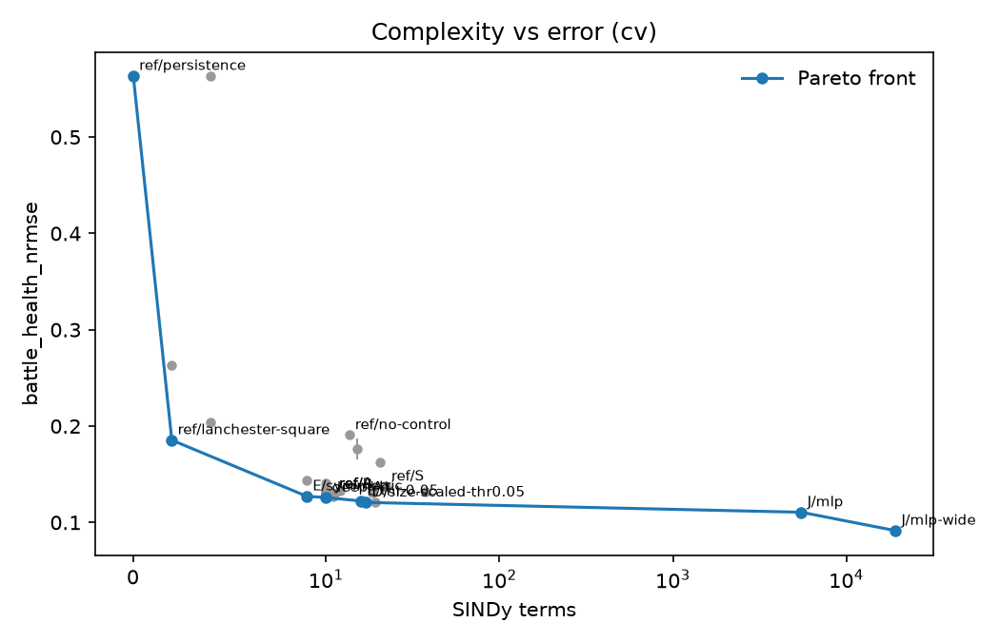
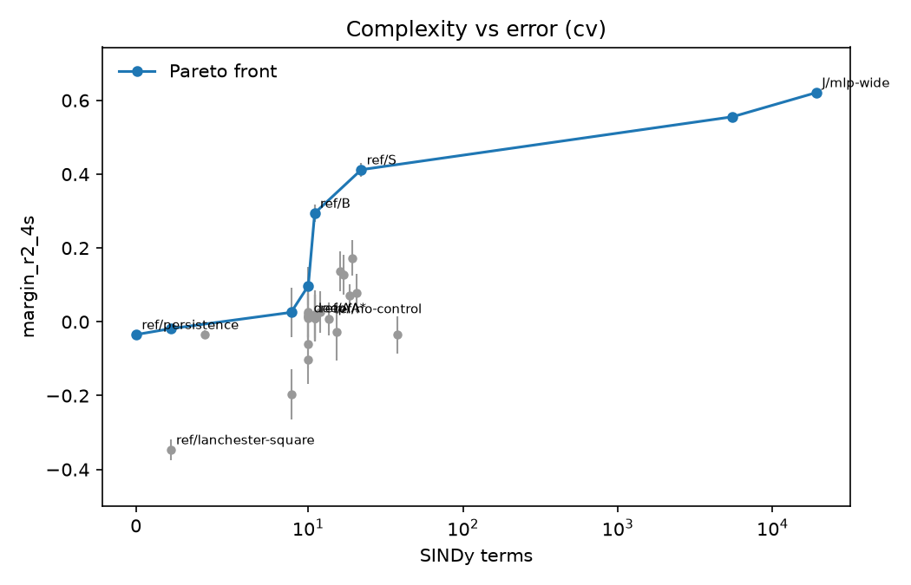

# Final exploration of the SINDy world model: report (18 Nov 2026)

Branch `final-exploration`. Supporting files in this folder:

- `00_audit.md`: what existed before the exploration.
- `01_literature.md`: the literature and library scan.
- `02_phase3_plan.md`: the pre-registration of the test.
- `03_test_results.md` / `.json`: the test, run once.
- `results_summary.md`, `results.csv`, `coefficients.csv`: every number, generated.
- `PROGRESS.md`: the running log with every intermediate reading.
- `05_gates_separate_k.md` / `.json`: the gates on the final model (19 Nov, post-hoc).

> **Update 19 Nov: the final model is now A\*-2k, not A\*.** A\* used one firepower coefficient
> for both sides because the units are identical. But the *controllers* differ: SMAClite's Red AI only
> picks up new targets within 5.375 (scan range + target radius), while Blue shoots out to 5.75. A's
> separate fit had already shown the gap (k_B 0.177 < k_R 0.186, non-overlapping intervals). A\*-2k
> keeps A's two coefficients and A\*'s alive law. It ties A\* on cv / val, transfers the margin to
> stalkers much better (0.195 vs 0.122), and passes the 17 Nov gates post-hoc (G7 not evaluated: it was
> not run on test2). Measuring Red's reach at 5.375 instead was tested and fails (§6). Sections 4-9
> are updated where they depended on the shared k; the 18 Nov text on A\* is kept where it is history.

## 1. What was done, in one paragraph

All models were refitted inside one harness (`src/sindy_wm/evaluation/harness.py`):

- **Splits, all by battle with fixed seeds:**
  - 5-fold cv on exp06 `train` (the screening number);
  - `val` (already used for every exp06 choice, so a second check only);
  - held-out battle size (fit on ≤ 25 units, score on 26-33);
  - stalkers (exp07 `train`, models scaled without refitting).
- **Metrics:** the gates' horizon metrics, plus new whole-battle closed-loop metrics.
- **Experiments:** 8 reference models, then screens on axes A/B (per-unit states and groups), C
  (phases), D/I (one model across battle sizes), E (thresholds, SR3 / SSR / FROLS, E-SINDy,
  symmetry), G (death laws) and J (a black-box MLP world model). Then a depth stage.
- **Test:** three candidates on different points of the Pareto front were scored **once** on fresh
  `test2` sets. These were collected on 18 Nov with new seeds, after the 17 Nov `final` sets were
  spent. The candidates and five expectations were pre-registered (`02_phase3_plan.md`) before the
  run. All five expectations were met.

## 2. Summary of every experiment (cv, mean over 5 folds)

Fold std: about 0.0005 for health 4 s, 0.02-0.06 for margin R² 4 s, 0.01 for alive 4 s, 0.003 for
battle nRMSE, 0.015 for winner accuracy. Full table with stds and the other splits:
`results_summary.md`.

| axis | experiment | health 4 s | mR² 4 s | alive 4 s | battle nRMSE | winner | blow-up | terms |
|---|---|---|---|---|---|---|---|---|
| ref | persistence | 0.225 | −0.04 | 2.82 | 0.564 | 0.623 | 0 | 0 |
| ref | Lanchester square / linear / mixed | 0.099 / 0.136 / 0.099 | −0.35 / −0.02 / −1.51 | 1.4-1.7 | 0.185 / 0.263 / 0.204 | 0.63-0.65 | 0 | 2-4 |
| ref | no control | 0.077 | 0.01 | 1.25 | 0.191 | 0.737 | 6% | 14 |
| ref | **A** (`model_derived` recipe) | 0.053 | 0.01 | 0.959 | 0.130 | 0.666 | 0 | 11 |
| ref | **B** (A's terms, rollout-fitted) | 0.050 | 0.29 | 0.841 | 0.129 | 0.688 | 0 | 11 |
| ref | **S** (B + share in reach as a state) | 0.048 | 0.41 | 0.810 | 0.137 | 0.688 | 0 | 22 |
| E | STLSQ threshold 0.02 / 0.05 / 0.1 / 0.2 / 0.3 | 0.052-0.060 | 0.17 / 0.14 / 0.03 / 0.01 / −0.06 | 0.95-1.03 | 0.121-0.141 | 0.66-0.70 | 2.6% / 2.2% / 0 / 0 / 0 | 19 / 16 / 12 / 11 / 10 |
| E | E-SINDy (30 bags) ± alive intent terms | 0.053 | 0.01 | 0.96 | 0.130 | 0.666 | 0 | 11 / 10 |
| E | SR3 / SR3 unbiased | 0.051 / 0.057 | 0.10 / −0.10 | 1.03 / 0.99 | 0.129 / 0.133 | 0.66 | 0 | 10 |
| E | SSR κ 0.01 / 0.1 | 0.063 / 0.058 | −0.03 / 0.08 | 1.09 / 1.03 | 0.176 / 0.163 | 0.68 | 2-4% | 15 / 21 |
| E | FROLS κ 0.01 / 0.1 | 0.067 / 0.225 | −0.20 / −0.04 | 1.12 / 2.82 | 0.144 / 0.564 | — | 0 | 9 / 4 |
| E | symmetric (one k, one p) / symmetric k only | 0.053 | 0.03 | 0.95 | 0.127 | 0.68 | 0 | 9 / 10 |
| G | alive: no intent terms / p = 1 | 0.053 / 0.052 | 0.01 / 0.02 | 0.97 / 0.97 | 0.130 / 0.136 | 0.67 / 0.68 | 0 | 10 |
| G | **alive: reach regressor** / rollout-fitted p | 0.051 / 0.051 | 0.02 / 0.02 | **0.905** / 0.900 | 0.127 / 0.128 | 0.67 / 0.68 | 0 | 11 |
| C | phase hybrid (approach / engaged / mop-up) | 0.052 | −0.04 | 0.93 | 0.132 | 0.66 | **5.5%** | 38 |
| D | size-scaled library, thr 0.15 / 0.05 | 0.053 / 0.052 | 0.01 / 0.13 | 0.96 / 0.95 | 0.130 / 0.121 | 0.67 / 0.68 | 0 / 2.2% | 11 / 17 |
| J | MLP world model (64) / wide (128) | 0.036 / **0.033** | 0.56 / **0.62** | 0.73 / **0.65** | 0.111 / **0.092** | 0.61 / 0.65 | 0 | 5 509 / 19 205 weights |
| deep | **A\*** (symmetric k + reach alive law) | 0.051 | 0.01 | 0.904 | 0.126 | 0.680 | 0 | 10 |
| deep | B\* / S\* (rollout refit started from A\*) | = B / = S (coefficients identical to ~1e-5) | | | | | | 11 / 22 |
| deep | share equation by one-step STLSQ | 0.052 | 0.07 | 0.90 | 0.131 | 0.67 | 0 | 19 |

Axes A/B were screened one step ahead with measured features (`screen_AB.py`), not as rollout
models. Results in §4.

## 3. Pareto plots





Over whole battles (top), the front runs persistence → Lanchester square → symmetric A (9 terms,
0.127) → A\* (10, 0.126) → threshold 0.05 (16) and size-scaled 0.05 (17), both with 2% blow-ups →
MLP (0.111 / 0.092). B (0.129) and S (0.137) sit off it: the trajectory fit doesn't help over whole
battles. On margin R² at 4 s (bottom), the front is symmetric A (9, 0.03) → SR3 (10, 0.10, via
shrinkage) → B (11, 0.29) → S (22, 0.41) → MLP (0.56 / 0.62): here the trajectory fit is what moves a
model up. (B\* and S\* sit on the points of B and S.) **The two metrics favour
different models.** That is itself a finding (§5, failure modes).

## 4. What helped, what didn't, what was inconclusive

"Better" means better than A in 5/5 cv folds, paired, unless stated otherwise.

**Helped**

1. **Fitting the death law on the regressor the rollout uses** (G/alive-reach, part of A\*). Alive
   4 s −0.055 ± 0.008, health 4 s −0.002, nRMSE −0.003. It matches the rollout-fitted law without
   rollout fitting, and it makes the alive exponents far less sensitive to the derivative estimate
   (§6). Held on test2.
2. **One firepower coefficient for both sides** (E/symmetric). Fewer numbers; ties or slightly
   better (nRMSE −0.0026, 5/5). *Revised 19 Nov:* not used in the final model. The units are
   identical but Red's AI acquires targets at a shorter radius (5.375 vs 5.75), and one k hides that
   asymmetry and transfers worse to stalkers (§6). Its small nRMSE gain is the only thing it adds.
3. **Trajectory refinement of A's support** (B), and the **share in reach as a state on top** (S).
   They replicate 17 Nov on fresh data: test2 margin R² 4 s 0.24 / 0.39 against A's −0.06. B\* = B
   shows the rollout fit has one optimum, whatever it starts from.

**Did not help (negative results)**

4. **Other optimizers** (SR3, SSR, FROLS). Once SR3's shrinkage is separated out (SR3 unbiased: worse
   everywhere), nothing beats STLSQ on this library. SR3's apparent gain is the same coefficient
   shrinkage that B finds by rollout fitting.
5. **E-SINDy for prediction**: identical to A. Its value is diagnostic (§6).
6. **Lower thresholds**: more margin R², but with extra, partly cancelling terms and 2-3% blow-ups.
7. **Explicit phases (Hybrid SINDy)**: 38 terms, 5.5% blow-ups, worse margin. The smooth gates already
   do the job.
8. **Size-dependent coefficients**: STLSQ keeps none at A's threshold. The coefficients are nearly
   size-free.
9. **Per-unit spatial states** (dispersion, hull, clusters, relative velocity, nearest-enemy
   distance): no one-step gain beyond units in reach (< 0.005 R² even with measured values).
10. **A hazard death law** (deaths ∝ units at one shot from death × enemy fire): its gain comes
    from the measured volley rhythm and disappears with a closure.
11. **S's share equation from one-step rates**: one-step STLSQ never finds S's relaxation term (wrong
    sign at low thresholds), and rollouts stay at A's level. S's gain needs trajectory fitting.

**Inconclusive**

12. **Volley timing** helps one-step damage prediction a lot (+0.08 R²), but earlier work
    (`sindyc_08`) shows it can't be forecast past about 1 s. I didn't test a cooldown-phase state.
13. **Overkill** helps a little in one-step screens (+0.02 health, +0.06-0.08 alive). It needs a target
    allocation model; not pursued.
14. **Winner accuracy from step 0** (§7): it moves against every fidelity metric, so I couldn't use it
    to rank models.

Not run (scope decision, 18 Nov): HMM / change-point phases (C, beyond the rule-based hybrid),
front/rear and cluster *rollout* models (B; screened only), Weak-form SINDy as a new axis (W exists),
PCA / delay embeddings and a SINDy autoencoder (H), per-type groups (no mixed scenario), PySR.

## 5. Test results (test2, run once; `03_test_results.md`)

| test2 (1000 battles) | health 4 s | mR² 4 s | battle nRMSE | Δ health vs A [95%] | Δ mR² vs A [95%] | Δ nRMSE vs A [95%] |
|---|---|---|---|---|---|---|
| A | 0.054 | −0.06 | 0.131 | | | |
| **A\*** | **0.052** | −0.05 | **0.128** | [−0.0023, −0.0016] | [−0.012, +0.031] | [−0.0042, −0.0017] |
| B | 0.050 | 0.24 | 0.132 | [−0.0052, −0.0027] | [+0.22, +0.40] | [−0.0025, +0.0037] |
| S | 0.048 | 0.39 | 0.138 | [−0.0073, −0.0043] | [+0.35, +0.55] | [+0.0012, +0.0118] |
| MLP (wide) | 0.032 | 0.60 | 0.094 | [−0.023, −0.020] | [+0.55, +0.77] | [−0.041, −0.034] |
| no control / Lanchester sq. / persistence | 0.078 / 0.100 / 0.222 | −0.03 / −0.38 / −0.04 | 0.188 / 0.184 / 0.564 | | | |

`test2_cf` (counterfactual branches) gives the same ordering. On `test2_stalkers` (scaled, no
refit), B and S transfer best (health 0.031 / 0.028, against A's 0.040). A\* is no better than A on
health and **worse on margin R² 4 s** (0.15 vs 0.25, [−0.12, −0.07]), as expected beforehand.

The test2 numbers match val closely (A\* 0.052 vs 0.053; B 0.050 vs 0.052; S 0.048 vs 0.050). So
there is no sign of overfitting to val.

## 6. Recommended final model: A\*-2k (switched 19 Nov; was A\*)

**Recommendation (hedged, 19 Nov):** use **A\*-2k** as the thesis's core interpretable model: A's
recipe with its two firepower coefficients k_B, k_R, plus the alive law fitted on the rollout's
regressor. Report **S** as "what the same structure reaches when fitted on trajectories", and the
**MLP** as the upper reference that puts the cost of interpretability in numbers.

**Why the switch from A\* (19 Nov, post-hoc; `PROGRESS.md`, axis K).**

- *Mechanism.* Red (attack-move AI) picks up a new target only within `minimum_scan_range` + target
  radius = 5.375; Blue shoots out to 5.75. Red keeps targets out to 5.75 and fights back against units
  shooting it. So some Red units counted in R_R (at 5.75) are not firing, and k_B (Blue's loss per Red
  unit in reach) should be lower than k_R. It is: 0.177 vs 0.186, bootstrap intervals not overlapping.
- *Accuracy.* A\*-2k ties A\* (cv health 4 s 0.0514 vs 0.0515; alive 0.905 vs 0.904). A\* is better on
  battle nRMSE by 0.0005-0.002 in 5/5 folds; A\*-2k on margin R² 4 s by about 0.01 in 4/5. On val the
  paired intervals (A\*-2k − A\*) are [+0.00003, +0.0004] for health 4 s and [−0.021, +0.004] for margin.
- *Transfer.* On stalkers A\*-2k's margin R² 4 s is 0.195 against A\*'s 0.122 (A: 0.215). The
  shared k, not the alive law, seems to cause A\*'s transfer loss.
- *Gates (post-hoc, `05_gates_separate_k.md`).* G1-G6 and G8 pass, horizon 2 s (val) / 3 s (cf). G3b:
  k_B 0.174-0.186, k_R 0.183-0.194 across SG 5 / 9 / 17 and weak 1 s / 2 s (≤ 4.7% from the median),
  k_wd ≤ 9.3%. **G7 not evaluated**: A\*-2k was not run on test2, which is spent. Its closest held-out
  evidence is A\*'s test2 result (same alive law, same distance equation).
- *The alternative that failed.* Measuring Red's reach at 5.375 (one k or two) is much worse (cv health
  4 s 0.064 / 0.089, margin R² −0.69 / −1.13). Least squares on the 5.375 reach gives k_B = 0.223,
  above the game's 0.213, so 5.375 undercounts the Red units that fire (sticky targets, fighting back).
  Red's effective reach lies between 5.375 and 5.75, close to 5.75.

**The 18 Nov reasons for A\*, which mostly carry over** (the alive law is the same):

- A\* is A with two changes that each have a physical reason and that held on fresh data:
  identical units get one firepower coefficient, and the death law is fitted without dividing by a
  noisy rate. It uses one-step SINDy / least squares only, so "SINDy found it" remains true in
  the sense it is true for A.
- It fixes A's pre-registered failure mode (G3b; post-hoc gate check below). A failed G3b because its alive term set moved
  with the derivative estimate. A\*'s term set stays the same under SG 5 / 9 / 17 / 33, partly by
  design, since its alive law has no selection step. Its alive exponents move about 5-10% (A:
  25-35%), and k stays within ±4%. **Caveat:** A\* has not been put through the 17 Nov gates.
  The weak-form estimates of G3b were not re-run, and the `final` sets are spent, so any such check
  is post-hoc.
- **What it doesn't fix:** margin R² at 4 s is still about 0 (B/S: 0.24-0.39). Stalker transfer is
  worse on the margin. Gains over A are small (health 4 s about −4%, alive about −6%).

**Post-hoc gate check (18 Nov, `04_gates_post_hoc.md`).** The 17 Nov gates were applied to A\* and,
as a control, A on `val` / `cf_*` / exp07 `val`, the sets `evaluate_final.py --dry-run` uses. G7
used the test2 / val ratio. A fails G3b exactly as on 17 Nov, with the same term-set changes at SG 17
and weak 1 s / 2 s, so the procedure reproduces.

| | G1 | G2 | G3a | G3b | G4 | G5 | G7 | G8 | horizon val / cf | verdict |
|---|---|---|---|---|---|---|---|---|---|---|
| A | ✓ | ✓ | ✓ | ✗ | ✓ | ✓ | ✓ (0.98) | ✓ | 2 / 3 s | not valid |
| A\* | ✓ | ✓ | ✓ | ✓ | ✓ | ✓ | ✓ (0.98) | ✓ | 2 / 3 s | **valid interpretable model, transfers** |
| A\*-2k (19 Nov) | ✓ | ✓ | ✓ | ✓ | ✓ | ✓ | not evaluated | ✓ | 2 / 3 s | **valid interpretable model (G7 n/a), transfers** |

A\*'s G3b values: across SG 5 / 9 / 17 and weak 1 s / 2 s, k = 0.179-0.190 (max 4.6% from the median),
k_wd within 8.2%. The term set is identical, partly by design, since the alive law has no selection
step. The alive exponents stay within p_B 0.63-0.70 and p_R 0.52-0.60. **Caveats:** this is
post-hoc, A\* was designed after looking at cv / val, and the reliable horizon is unchanged from A
(2-3 s).

If prediction at 2-4 s matters more than readability for a chapter (RQ3), S is the better choice,
at the cost of 22 terms, two G2 sign failures (Red's `sf_adv`, `sf_hold`) and rollout fitting.

**A\*-2k's equations** (fitted on all of `train`; 95% ranges from 30 battle-bootstrap refits with
closures fixed, `final_Astar2k_bootstrap.csv`):

```
H_B' = k_B·R_R                       k_B   = −0.1770  [−0.1775, −0.1765]
H_R' = k_R·R_B + k_wd·R_B·wd         k_R   = −0.1861  [−0.1871, −0.1852]
                                     k_wd  = +0.1633  [+0.1623, +0.1647]
d'   = −6.008 c·adv − 3.158 c·wd + 0.296 f·wd − 3.183 c·hold·far − 5.915 c·hold·contact
       (ranges: ±0.03-0.08 on each closing speed, flee 0.284-0.311)
(ln A_B)' = p_B (ln H_B)'            p_B   = 0.663  [0.659, 0.666]
(ln A_R)' = (p_R + p_f·focus)(ln H_R)'   p_R = 0.539 [0.533, 0.545], p_f = 0.238 [0.229, 0.248]
R = A·Φ((ρ − gap)/spread), ρ = 5.75 (the game's reach), λ, β, g fitted; movement gates c, f fitted (curve_fit)
```

(p is fitted as A' = p·k·R_enemy·A/H with each side's own k, the form the rollout uses. A\*, for
comparison: one k = −0.1819, k_wd = +0.1590, p_B = 0.645, p_R = 0.552, p_f = 0.244.)

**Physical reading of each term** (common scale: health 1 = ten marines × 45 hp; R in tens of units):

- **k_R = −0.186, k_B = −0.177.** Each Blue unit in reach removes 0.0186 × 450 ≈ 8.4 hp/s of Red's
  health; each Red unit in reach removes 8.0 hp/s of Blue's. A firing marine deals 6 hp per 0.625 s =
  9.6 hp/s (0.213 on this scale), so about 87% of Blue's and 83% of Red's units in reach are
  effectively firing. The units are identical; the 5% gap matches Red's shorter acquisition radius
  (5.375 vs 5.75): Red units at the edge of reach that nobody is shooting do not start firing.
- **k_wd = +0.163.** When Blue withdraws, the damage Red takes per Blue unit in reach drops by
  0.163 / 0.186 ≈ 88%: withdrawing units mostly walk instead of shooting.
- **Distance.** Mutual advance closes at 6.0 map units/s, about two walking speeds (2 × 3.15).
  Holding before contact closes at 3.18 (only Red walks: 3.15). Holding in contact closes at 5.9
  (Blue steps in again once it has targets). Withdraw closes at 3.16 inside the gate, because Red
  chases at its own speed, and adds a small flee term (+0.30) beyond it.
- **p_B = 0.663, p_R = 0.539.** Units-alive is less elastic than health: health is lost faster than
  units die, because damage spreads over several units before one dies. **Focus fire raises Red's
  kill conversion by 44%** (0.54 → 0.78), the expected effect of concentrating fire. Blue and Red
  differ: Red's sticky-nearest targeting spreads damage more.

## 7. Known failure modes

1. **The margin beyond about 2-3 s** (A, A\*, A\*-2k). Margin R² at 4 s is about 0 on test2. The reach closure
   predicts contact too early and too fully when formations are scattered (`sindyc_07`). B / S
   compensate with smaller firepower coefficients and an offset decay, but then the coefficients
   read less like physics.
2. **Whole battles.** Every SINDy model's duration error is about 3 s on battles of about 9 s. S is
   *worse* than A over whole battles although best at 1-8 s.
3. **Withdraw-heavy battles.** A's whole-battle winner accuracy drops from 0.73 (no withdraw) to 0.59
   (> 35% withdraw) on a cv fold.
4. **Winner accuracy from step 0 is not a fidelity measure here.** The no-control model (0.74) and
   the worst threshold (0.70) beat A (0.67), and the MLP (0.65) is below A. With close battles and a
   59% Blue win rate, it rewards a bias towards Blue. The E-SINDy win probability is barely
   calibrated better than a 0/1 call (Brier 0.331 vs 0.334): the members barely differ, because the
   uncertainty sits in the closure.
5. **Transfer.** A\*'s margin transfers worse to stalkers than A's (0.12 vs 0.21). A\*-2k, with the
   same alive law but separate k, transfers nearly as well as A (0.195), so the loss was mostly the
   shared k.
6. **The formation is held** at its start value in every rollout. The interpretable models have no
   formation dynamics.
7. **Bootstrap intervals understate the uncertainty.** They cover data noise only, not the closure
   (fitted once) or the derivative estimate.

## 8. Open questions

- Why does the no-control model call winners better? Diagnostic so far: A errs on withdraw-heavy
  battles, and no-control predicts Blue wins more often. Is it the distance under withdraw or the
  87% fire reduction?
- Can a reach closure with a slow relaxation term be identified without trajectory fitting? The
  one-step STLSQ result says not from SG rates. A weak-form fit of the share equation is untested.
- A\* and A\*-2k pass the 17 Nov gates post-hoc, on val (`04_gates_post_hoc.md`, `05_gates_separate_k.md`). A pre-registered confirmation would need yet another fresh test set; A\*-2k also has no test2 number.
- Is the stalker transfer loss of A\* in the alive law or in k? Mostly k (19 Nov): A\*-2k, same alive law, transfers nearly as well as A.
- Red's effective reach: 5.375 undercounts the Red units that fire, 5.75 overcounts them. Can it be
  derived from the game's rules (target retention, fighting back) rather than fitted?
- Blue decides every step_mul = 2 ticks, Red every tick. Firing is checked every tick under a held
  attack order, so the expected loss is at most one tick per kill. Untested.
- Would a cooldown-phase state (volley timing) help at horizons under 1 s, the planner's step?

## 9. Paragraphs to adapt for the thesis

*(Drafts, written as requested on 18 Nov. Numbers are cv unless marked test2.)*

**Evaluation protocol.** All models were refitted within a single harness that splits data by
battle. Five-fold cross-validation on the 6000 training battles served for screening. The
validation set had been used for earlier modelling choices, so it served only as a second check. A
held-out battle-size split and a stalker transfer split tested generalisation. Besides the horizon
metrics used for the acceptance gates, each model was rolled out once per battle from the first
step to the end under the recorded intents. After the 17 November test sets had been used, a fresh
test set (1000 battles, 3600 counterfactual branches and 300 stalker battles) was collected with
new seeds. Three candidates and five expectations were registered before it was read, and it was
evaluated once. All five expectations were met.

**The death law.** In the original model the exponent linking units alive to health was fitted by
dividing smoothed rates, which biases it towards zero (errors in variables). Rewriting the same law
with the regressor used in rollouts, A' = p·k·R_enemy·A/H, removes the bias without fitting on
trajectories. The exponent rises from 0.52 to 0.65 for Blue, near the rollout-fitted 0.77, and
the alive error at 4 s falls by 6% in every fold. The exponent also becomes far less sensitive to
the smoothing window (5-10% variation across Savitzky-Golay windows 5-33, against 25-35%).

**Side asymmetry.** Marines on both sides are identical, but the two sides are not controlled the
same way: the built-in Red AI only acquires new targets within 5.375 map units, while the scripted
Blue team can shoot out to 5.75. The fitted firepower coefficients reflect this: Red deals 0.177 per
unit in reach, Blue 0.186 (about 83% and 87% of the game's maximum rate), with non-overlapping
bootstrap intervals. Imposing one coefficient for both sides costs almost nothing in accuracy, but it
hides the asymmetry and halves how well the predicted margin transfers to stalkers. Counting Red's
units in reach at 5.375 instead overcorrects (the implied rate exceeds the game's maximum), because
Red keeps targets it already has and fights back. Focus fire raises Red's kill conversion by 44%
(exponent 0.54 → 0.78).

**What did not help.** Replacing STLSQ with SR3, stepwise sparse regression or forward orthogonal
regression did not improve the model once SR3's coefficient shrinkage was accounted for. Explicit
battle phases added 27 terms and made 5.5% of rollouts unstable. Size-dependent coefficients were
not selected. Per-unit spatial features (dispersion, hull area, clusters, relative velocity) added
nothing to one-step damage prediction beyond the number of units in reach. Bagging (E-SINDy) kept
every term of the model in all 30 resamples, and the alive-equation control terms that had failed
the robustness gate in fewer than 13%. So that failure reflects sensitivity to the derivative
estimate, not to the data.

**Trajectory fitting and the closure.** The model's limit is the reach closure, not the team-level
state. A black-box world model on the same inputs reaches a health error of 0.032 and a margin R²
of 0.60 at 4 s on the test set, against 0.052 and −0.05 for the interpretable model (A\*; the final
variant with two firepower coefficients ties it on cross-validation but was not run on the test set). The
predictive gains of the extended models (B, S) come from fitting coefficients on trajectories:
one-step sparse regression on the measured share rate never identifies the slow relaxation term
that makes S work. Refitting on trajectories from two different starting models converged to the
same coefficients. S closes about two thirds of the margin gap to the black box, but it is worse
over whole battles and has two terms with unexpected signs.

**Whole battles and winners.** Over complete battles every sparse model misjudges the duration by
about 3 s (battles last about 9 s). Winner accuracy from the first step (0.67 for the core model)
turned out not to track trajectory fidelity: a model without intents and a black-box model ranked
in the opposite order. Winner accuracy is therefore reported but not used to choose models.

## 10. Reproducing the recommended model

```bash
uv run --extra explore scripts/build_final_model.py --model 'A*2k' --bootstrap 30
```

`configs/final_model.yaml` names the model (`A*2k` since 19 Nov; `A*` gives the 18 Nov model) and the
data. The script reads exp06 `train` only, fits the closures and the model, prints the equations and
writes the bootstrap table. Every harness row can be
regenerated with `experiments/final_exploration/run.py <module>`. Rows already in the table are
skipped, never overwritten.
